# wuji-description

**English** | [简体中文](README_zh.md)

[](LICENSE) [](https://github.com/wuji-technology/wuji-description/releases)

URDF, MuJoCo XML (MJCF), and USD models for Wuji hands, plus STEP files and drawings for mechanical integration.

[Hand 2.2](#wuji-hand-22) · [Hand 2.1](#wuji-hand-21) · [Quick Start](#quick-start) · [CAD and Mounting](#cad-and-mounting) · [Wuji Hand](#wuji-hand) · [Wuji Glove](#wuji-glove)

## Wuji Hand 2.2

Hand 2.2 adds a tactile-sensor pad to each fingertip. Both hands come in Bare, Cover, and Glove variants.


<details open>
<summary><strong>USD · Isaac Sim</strong></summary>

<table>
<tr>
<th width="33%">Bare</th>
<th width="33%">Cover</th>
<th width="33%">Glove</th>
</tr>
<tr>

<td>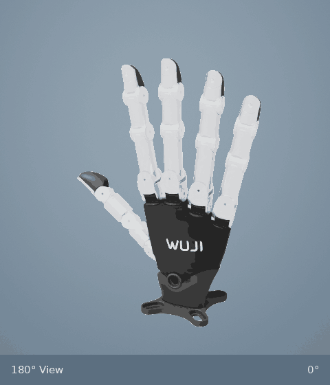</td>

<td>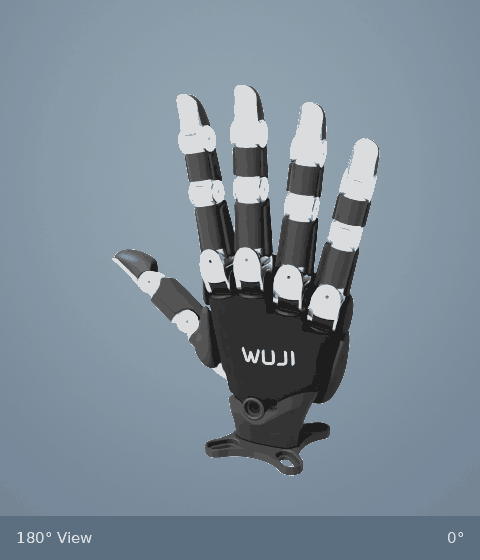</td>

<td>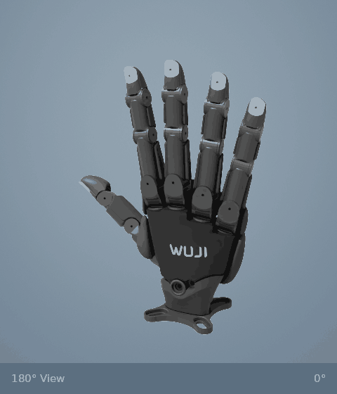</td>

</tr>
</table>

</details>


<details open>
<summary><strong>XML · MuJoCo</strong></summary>

<table>
<tr>
<th width="33%">Bare</th>
<th width="33%">Cover</th>
<th width="33%">Glove</th>
</tr>
<tr>

<td>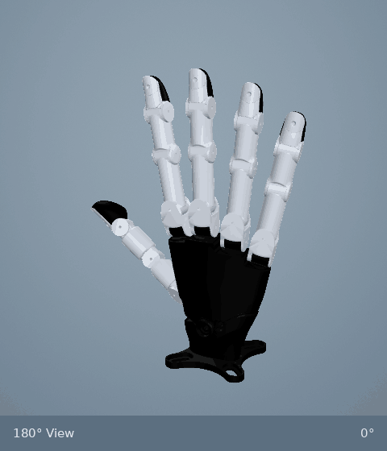</td>

<td>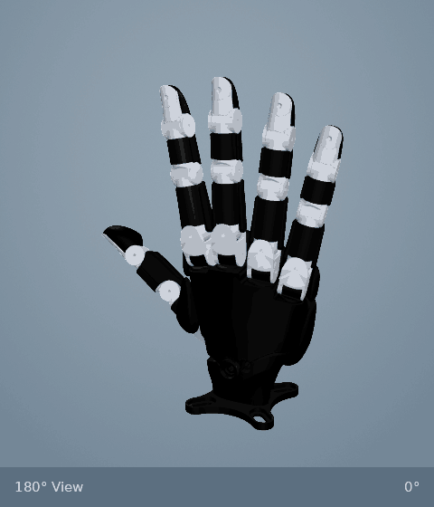</td>

<td>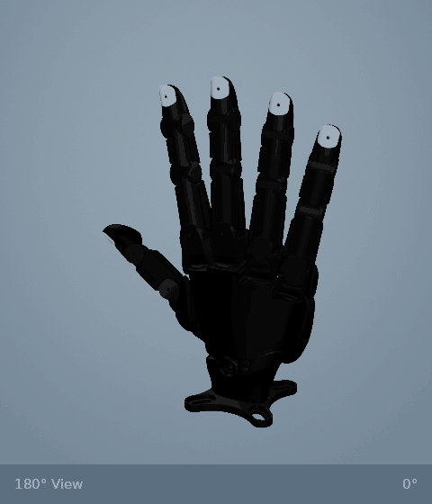</td>

</tr>
</table>

</details>


Each preview rotates 180°, moves all 20 joints in both directions, then rotates another 180°. Rotation stays at 10°/s. Hand 2.1 and Hand 2.2 use the same sequence and timing in USD and XML.


[Model Files](hand2/hand2_2/body/) · [CAD and Drawings](hand2/hand2_2/attachment/)


## Wuji Hand 2.1

Hand 2.1 provides the same 20-joint layout without fingertip tactile pads. Both hands come in Bare, Cover, and Glove variants.


<details open>
<summary><strong>USD · Isaac Sim</strong></summary>

<table>
<tr>
<th width="33%">Bare</th>
<th width="33%">Cover</th>
<th width="33%">Glove</th>
</tr>
<tr>

<td>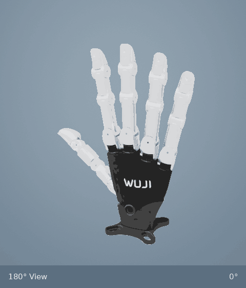</td>

<td>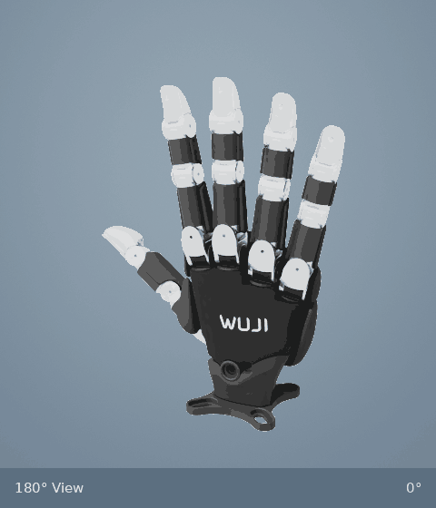</td>

<td>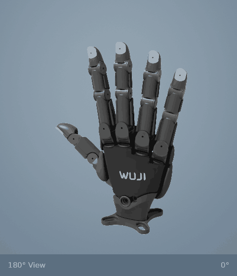</td>

</tr>
</table>

</details>


<details open>
<summary><strong>XML · MuJoCo</strong></summary>

<table>
<tr>
<th width="33%">Bare</th>
<th width="33%">Cover</th>
<th width="33%">Glove</th>
</tr>
<tr>

<td>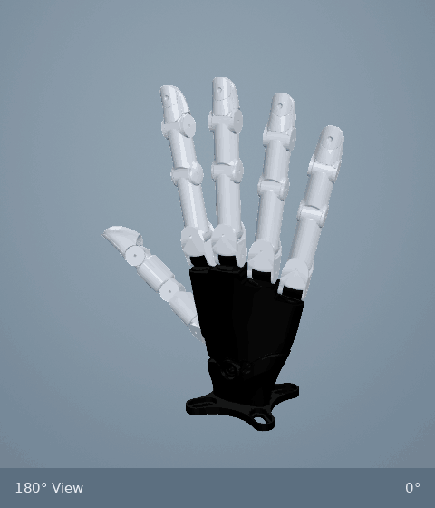</td>

<td>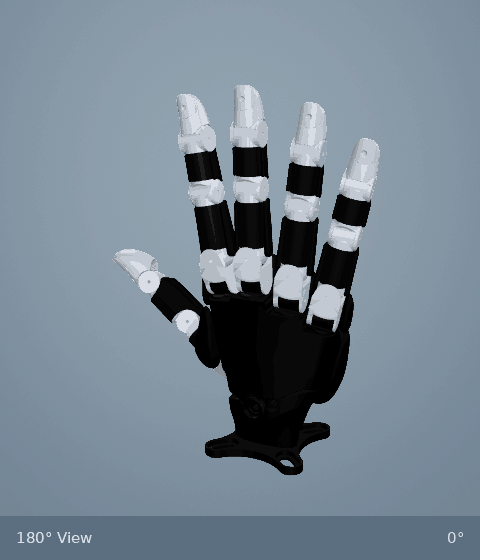</td>

<td></td>

</tr>
</table>

</details>


[Model Files](hand2/hand2_1/body/) · [CAD and Drawings](hand2/hand2_1/attachment/)


## Quick Start

### Install Hand 2.2 with pip

Requires Python 3.10 or later. The [PyPI package](https://pypi.org/project/wuji-hand2-2-description/) includes MJCF, URDF, USD, and meshes.

```bash
python -m pip install wuji-hand2-2-description mujoco
```

Open the right Glove model in MuJoCo:

```python
import mujoco
import mujoco.viewer
from wuji_hand2_2_description import root

model = mujoco.MjModel.from_xml_path(str(root() / "mjcf/right_with_glove.xml"))
mujoco.viewer.launch(model)
```

Use `root() / "urdf"` or `root() / "usd"` for the other formats. The package version matches a repository release. A checkout of `main` may contain changes not yet published to PyPI.

### Clone All Models and CAD Files

Use the repository for Hand 2.1, Wuji Hand, Wuji Glove, ROS2 packages, and mechanical files:

```bash
git clone https://github.com/wuji-technology/wuji-description.git
cd wuji-description
```

Unless noted otherwise, paths below are relative to this repository root.

### Load a Model

| Format | Hand 2.2 Right Glove Model |
|--------|---------------------------|
| USD | [USD File](hand2/hand2_2/body/usd/right_with_glove/wujihand2_2_glove.usd) |
| XML (MJCF) | [MJCF File](hand2/hand2_2/body/mjcf/right_with_glove.xml) |
| URDF | [Relative Mesh Paths](hand2/hand2_2/body/urdf/right_with_glove.urdf) |
| ROS URDF | [Package Mesh Paths](hand2/hand2_2/body/urdf/right_with_glove-ros.urdf) |

For MuJoCo:

```bash
python -m mujoco.viewer --mjcf=hand2/hand2_2/body/mjcf/right_with_glove.xml
```

For a local URDF viewer such as [urdf-viz](https://github.com/openrr/urdf-viz):

```bash
urdf-viz hand2/hand2_2/body/urdf/right_with_glove.urdf
```

For Isaac Sim, open the linked `.usd` file from the local checkout. Keep its directory intact, including `configuration/` and `textures/`. Keep the shared `meshes/` directory when copying URDF or MJCF files.

For Hand 2.1, replace `hand2_2` with `hand2_1`, including in the USD filename. For the left hand, replace `right` with `left`.

### Choose an Appearance

| Variant | Appearance | Filename Suffix | USD Filename Suffix |
|---------|------------|-----------------|---------------------|
| Bare | Silver finger hardware and a black palm | No suffix | No suffix |
| Cover | Adds black covers around the finger bodies | `_with_cover` | `_cover` |
| Glove | Black hardware with silver nail surfaces | `_with_glove` | `_glove` |

Within `hand2/hand2_2/body/`, the right Bare model is `mjcf/right.xml` or `usd/right/wujihand2_2.usd`. The Cover model is `mjcf/right_with_cover.xml` or `usd/right_with_cover/wujihand2_2_cover.usd`.

Model names below use Hand 2.2, right hand. For Hand 2.1 or the left hand, replace `2_2` with `2_1` or `right` with `left`.

| Variant | URDF Robot / MJCF Model Name | USD Root Prim |
|---------|-----------------------------|---------------|
| Bare | `wujihand2_2-right` | `/wujihand2_2_right` |
| Cover | `wujihand2_2-right-cover` | `/wujihand2_2_right_cover` |
| Glove | `wujihand2_2-right-glove` | `/wujihand2_2_right_cover` |

Glove uses the same USD root prim name as Cover.

Glove is an appearance of the robot hand. [Wuji Glove](#wuji-glove) is a separate motion-tracking device. Cover and Glove share mass, inertia, joints, and collision geometry. They use rigid cover links, with no deformable glove simulation or added physical glove mass.

### ROS2

Replace `<distro>` with your installed ROS2 distribution. Clone the full repository into the ROS2 workspace, then build the required packages:

```bash
source /opt/ros/<distro>/setup.bash
mkdir -p ~/ros2_ws/src
cd ~/ros2_ws/src
git clone https://github.com/wuji-technology/wuji-description.git
cd ..
rosdep install --from-paths src --ignore-src -r -y
colcon build --packages-select wuji_hand2_2_description wuji_hand2_1_description
source install/setup.bash
```

Use the installed `-ros.urdf` with your `robot_state_publisher` launch configuration. Hand 2 packages include model assets, without a display launch file or RViz preset.

```bash
check_urdf "$(ros2 pkg prefix wuji_hand2_2_description)/share/wuji_hand2_2_description/urdf/right_with_glove-ros.urdf"
```

`check_urdf` checks the URDF structure. It does not test mesh loading in a viewer.

## CAD and Mounting

| Product | Full-Hand STEP | Mounting Interfaces, Adapters, and Flange |
|---------|----------------|-----------------------------------------|
| Hand 2.2 | [STEP Assemblies](hand2/hand2_2/body/step/) | [STEP Models and PDF Drawings](hand2/hand2_2/attachment/) |
| Hand 2.1 | [STEP Assemblies](hand2/hand2_1/body/step/) | [STEP Models and PDF Drawings](hand2/hand2_1/attachment/) |

Each Hand 2 revision's `body/step/` contains the Beta full-hand assemblies. These STEP files aren't regenerated from the current Bare, Cover, or Glove simulation models.

The `mount` files in each revision's `attachment/` describe the palm mounting interface, while `adapter` and `adapter-flange` files describe the arm-side components. Use the PDF drawings for hole positions, threads, and tolerances.

Get CAD and drawings from the repository checkout. The Hand 2 ROS2 and pip packages do not install them.

## Wuji Hand

[Body Models](hand/body/) · [Thumb Soft-Pad Variant](hand/body-with-soft/) · [Attachments](hand/attachment/)

The first-generation Wuji Hand includes URDF, MJCF, USD, a ROS2 display launch file, and RViz presets.

```bash
python -m mujoco.viewer --mjcf=hand/body/mjcf/right.xml
```

In a ROS2 workspace containing the full repository:

```bash
colcon build --packages-select wuji_description
source install/setup.bash
ros2 launch wuji_description display.launch.py hand:=right
```

Use `hand:=left` for the left hand. In Isaac Sim, open `hand/body/usd/right/wujihand.usd` or the corresponding left-hand file.

<details>
<summary>Soft Pad and Attachments</summary>

`hand/body-with-soft/` adds a fixed thumb pad. Its `_simplified` URDF, MJCF, and USD variants use reduced collision meshes with the same visual geometry.

The default display launch file doesn't load these attachments. Add model attachments through fixed joints.

- [Impact-Resistant Attachment](hand/attachment/impact-resistant-attachment/): STL, URDF, MJCF, and USD
- [Arm Adapters](hand/attachment/step/): STEP, drawings, and [Installation Instructions](hand/attachment/step/Adapter-Installation-Instructions.md)
- [Unitree G1 Adapter](hand/attachment/unitree-g1-attachment/): STL
- [RL Mounting Base](hand/attachment/wuji-hand-rl-open-source-base/): 3MF, STEP, drawing, and bill of materials

</details>

## Wuji Glove

[URDF Models](glove/body/urdf/) · [Transmitter Cover](glove/body/step/) · [Mounting Attachments](glove/attachment/)

Wuji Glove is a hand motion-tracking model with 21 revolute joints per hand, a wrist transmitter base, and a receiver coil on each fingertip. Attachments include the glove mounting interface and adapters for a PICO tracker or PICO 4 Ultra controller.

```bash
urdf-viz glove/body/urdf/right.urdf
```

## Model Details

<details>
<summary>Hand 2 Frames, Mass, and Meshes</summary>

Both revisions have 20 actuated revolute joints, a mount root (`l_mount` or `r_mount`), a wrist IMU frame, and five fingertip query frames. Hand 2.2 adds five fixed tactile-sensor pad links. Their mass allocations are provisional pending measurement.

The frame and joint names below apply to Bare, Cover, and Glove. The prefixes `l_` and `r_` indicate the left and right hands.

| Item | Name |
|------|------|
| Root link | `{l,r}_mount` |
| Wrist IMU frame | `{l,r}_wrist_imu_frame` |
| Fingertip query frame | `{l,r}_{finger}_tip` |
| Joint examples | `r_thumb_cmc_flex`, `r_index_finger_mcp_abd` |

`{finger}` is `thumb`, `index_finger`, `middle_finger`, `ring_finger`, or `pinky`. The IMU and fingertip query frames are links in URDF and sites in MJCF.

| Revision | Variant | URDF Links per Hand | Configured Mass per Hand |
|----------|---------|---------------------|--------------------------|
| Hand 2.2 | Bare | 33 | 687.8 g |
| Hand 2.2 | Cover / Glove | 54 | 783.6 g |
| Hand 2.1 | Bare | 28 | 687.8 g |
| Hand 2.1 | Cover / Glove | 49 | 783.6 g |

These values describe the models in this checkout. They are not measurements of an assembled hand with a glove. The 21 rigid covers total 95.8 g per hand, using supplied weighing data, half-mass allocations, and shared values for matching parts. Cover inertia assumes uniform density within each mesh.

Hardware and cover meshes stay in `meshes/{left,right}/`. The Glove URDF and MJCF models use visual partitions under `visual_nails/`, while collisions keep the complete meshes. USD uses material subsets for the silver nail surfaces. The Cover cylinders affect visuals only.

The fingertip query frames and wrist IMU frame have no mesh geometry. In USD, each carries a `1e-7 kg` placeholder mass to avoid PhysX assigning a default mass. The USD drive gains hold the initial pose on Play. Set drive parameters in the consuming simulation as needed.

</details>

<details>
<summary>Repository Structure</summary>

```text
.
├── hand2/
│   ├── hand2_2/
│   │   ├── body/          # URDF, MJCF, USD, meshes, and full-hand STEP
│   │   └── attachment/    # Palm interfaces, adapters, and flange
│   └── hand2_1/           # Same layout as Hand 2.2
├── hand/
│   ├── body/             # Wuji Hand models, ROS2 launch, and RViz
│   ├── body-with-soft/    # Thumb soft-pad variant
│   └── attachment/       # Adapters and mounting bases
├── glove/
│   ├── body/             # Motion-tracking URDF and transmitter cover
│   └── attachment/       # Glove and PICO mounting interfaces
└── assets/readme/        # Model previews
```

</details>

## Documentation

| Product | Model Integration | Mechanical Integration |
|---------|-------------------|------------------------|
| Hand 2.2 | [Models and Loading](https://docs.wuji.tech/docs/en/wuji-hand/latest/model-integration) | [Mounting and CAD](https://docs.wuji.tech/docs/en/wuji-hand/latest/hardware-integration#palm-interface-step-and-drawings) |
| Hand 2.1 | [Models and Loading](https://docs.wuji.tech/docs/en/wuji-hand/beta1/hardware-integration#get-and-load) | [CAD Files](hand2/hand2_1/attachment/) |
| Wuji Glove | [Models and Loading](https://docs.wuji.tech/docs/en/wuji-glove/latest/model-integration) | [Mounting and CAD](https://docs.wuji.tech/docs/en/wuji-glove/latest/hardware-integration) |

## Contact

Contact [support@wuji.tech](mailto:support@wuji.tech).
