# wuji-description

[English](README.md) | **简体中文**

[](LICENSE) [](https://github.com/wuji-technology/wuji-description/releases)

Wuji 灵巧手的 URDF、MuJoCo XML（MJCF）和 USD 模型，以及机械集成所需的 STEP 文件和图纸。

[Hand 2.2](#wuji-hand-22) · [Hand 2.1](#wuji-hand-21) · [快速开始](#快速开始) · [CAD 与安装](#cad-与安装) · [Wuji Hand](#wuji-hand) · [Wuji Glove](#wuji-glove)

## Wuji Hand 2.2

Hand 2.2 的每个指尖均配有触觉传感垫。左手和右手均提供 Bare、Cover 和 Glove 3 种外观。


<details open>
<summary><strong>USD · Isaac Sim</strong></summary>

<table>
<tr>
<th width="33%">Bare</th>
<th width="33%">Cover</th>
<th width="33%">Glove</th>
</tr>
<tr>

<td>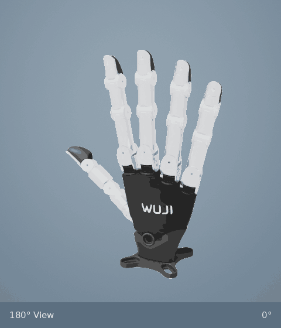</td>

<td>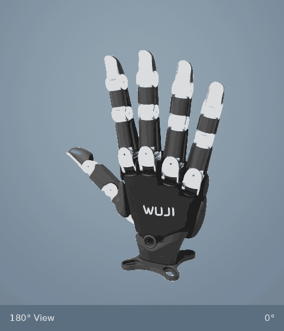</td>

<td>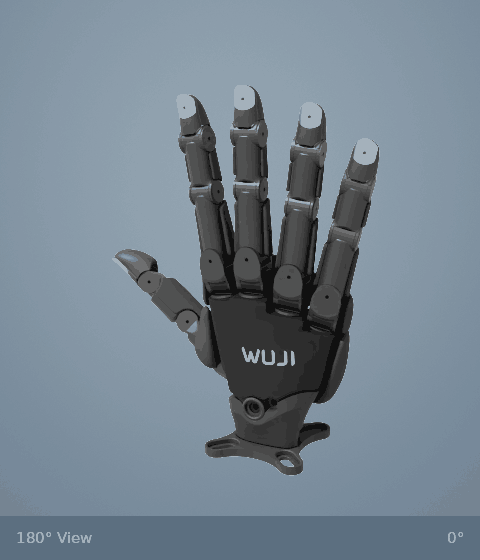</td>

</tr>
</table>

</details>


<details open>
<summary><strong>XML · MuJoCo</strong></summary>

<table>
<tr>
<th width="33%">Bare</th>
<th width="33%">Cover</th>
<th width="33%">Glove</th>
</tr>
<tr>

<td>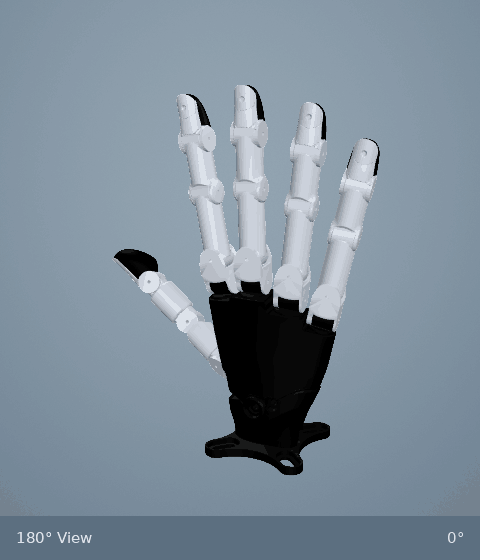</td>

<td>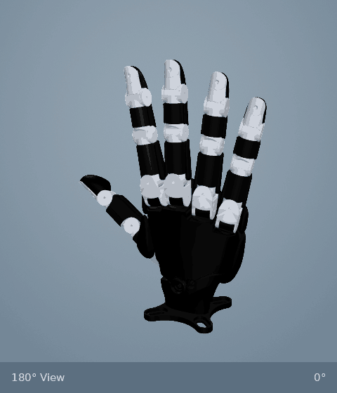</td>

<td>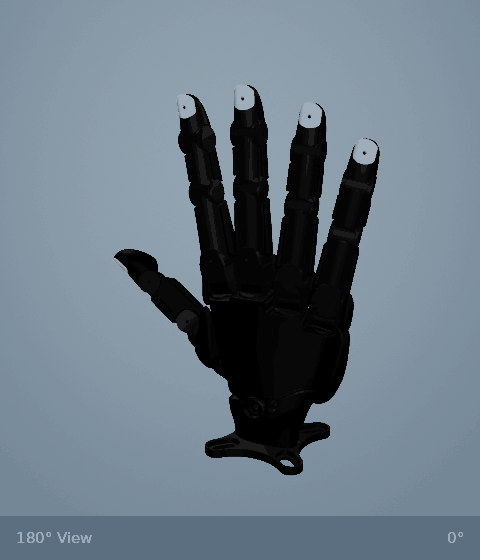</td>

</tr>
</table>

</details>


每张动图先旋转 180°，再展示全部 20 个关节的正负方向运动，最后再旋转 180°。旋转速度为 10°/s。Hand 2.1、Hand 2.2 的 USD 和 XML 预览使用相同的动作顺序和时序。


[模型文件](hand2/hand2_2/body/) · [CAD 与图纸](hand2/hand2_2/attachment/)


## Wuji Hand 2.1

Hand 2.1 采用相同的 20 关节布局，不含指尖触觉垫。左手和右手均提供 Bare、Cover 和 Glove 3 种外观。


<details open>
<summary><strong>USD · Isaac Sim</strong></summary>

<table>
<tr>
<th width="33%">Bare</th>
<th width="33%">Cover</th>
<th width="33%">Glove</th>
</tr>
<tr>

<td>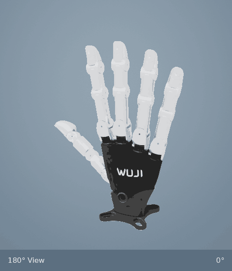</td>

<td>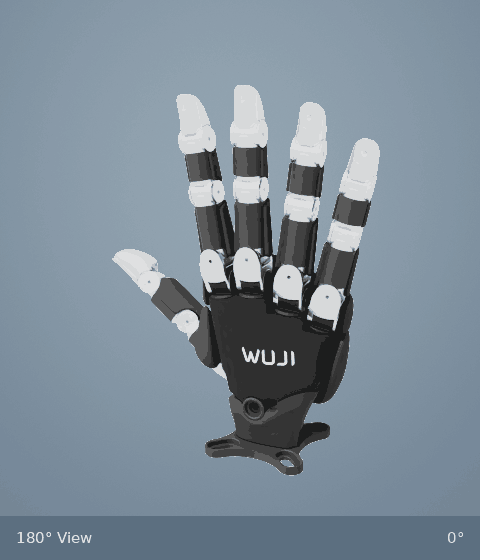</td>

<td>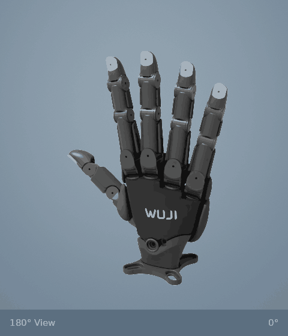</td>

</tr>
</table>

</details>


<details open>
<summary><strong>XML · MuJoCo</strong></summary>

<table>
<tr>
<th width="33%">Bare</th>
<th width="33%">Cover</th>
<th width="33%">Glove</th>
</tr>
<tr>

<td>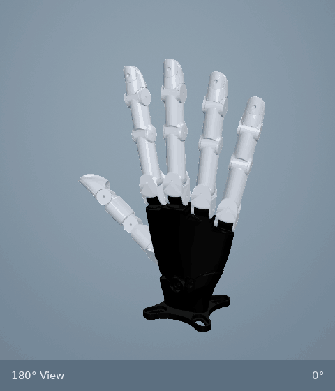</td>

<td>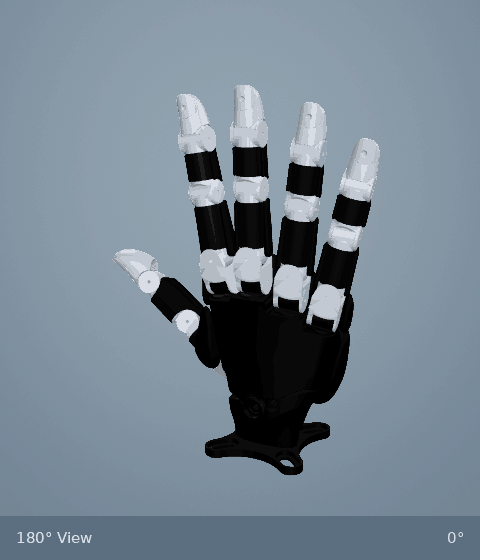</td>

<td></td>

</tr>
</table>

</details>


[模型文件](hand2/hand2_1/body/) · [CAD 与图纸](hand2/hand2_1/attachment/)


## 快速开始

### 使用 pip 安装 Hand 2.2

需要 Python 3.10 或更高版本。[PyPI 软件包](https://pypi.org/project/wuji-hand2-2-description/)包含 MJCF、URDF、USD 和网格文件。

```bash
python -m pip install wuji-hand2-2-description mujoco
```

在 MuJoCo 中打开右手 Glove 模型：

```python
import mujoco
import mujoco.viewer
from wuji_hand2_2_description import root

model = mujoco.MjModel.from_xml_path(str(root() / "mjcf/right_with_glove.xml"))
mujoco.viewer.launch(model)
```

通过 `root() / "urdf"` 或 `root() / "usd"` 获取其他格式。软件包版本对应仓库的发布版本，`main` 分支可能包含尚未发布到 PyPI 的修改。

### 克隆全部模型和 CAD 文件

从仓库获取 Hand 2.1、Wuji Hand、Wuji Glove、ROS2 软件包和机械文件：

```bash
git clone https://github.com/wuji-technology/wuji-description.git
cd wuji-description
```

除非另有说明，以下路径均相对于本仓库根目录。

### 加载模型

| 格式 | Hand 2.2 右手 Glove 模型 |
|--------|---------------------------|
| USD | [USD 文件](hand2/hand2_2/body/usd/right_with_glove/wujihand2_2_glove.usd) |
| XML (MJCF) | [MJCF 文件](hand2/hand2_2/body/mjcf/right_with_glove.xml) |
| URDF | [相对网格路径](hand2/hand2_2/body/urdf/right_with_glove.urdf) |
| ROS URDF | [软件包网格路径](hand2/hand2_2/body/urdf/right_with_glove-ros.urdf) |

使用 MuJoCo：

```bash
python -m mujoco.viewer --mjcf=hand2/hand2_2/body/mjcf/right_with_glove.xml
```

使用本地 URDF 查看器，例如 [urdf-viz](https://github.com/openrr/urdf-viz)：

```bash
urdf-viz hand2/hand2_2/body/urdf/right_with_glove.urdf
```

在 Isaac Sim 中打开本地仓库内上述链接对应的 `.usd` 文件。保留完整目录，包括 `configuration/` 和 `textures/`。复制 URDF 或 MJCF 文件时，保留共享的 `meshes/` 目录。

加载 Hand 2.1 时，将路径及 USD 文件名中的 `hand2_2` 替换为 `hand2_1`。加载左手时，将 `right` 替换为 `left`。

### 选择外观

| 类型 | 外观说明 | 文件名后缀 | USD 文件名后缀 |
|---------|------------|-----------------|---------------------|
| Bare | 银色手指硬件和黑色手掌 | 无后缀 | 无后缀 |
| Cover | 手指外部增加黑色外壳 | `_with_cover` | `_cover` |
| Glove | 黑色硬件搭配银色指甲面 | `_with_glove` | `_glove` |

以 `hand2/hand2_2/body/` 为基准，右手 Bare 模型为 `mjcf/right.xml` 或 `usd/right/wujihand2_2.usd`。Cover 模型为 `mjcf/right_with_cover.xml` 或 `usd/right_with_cover/wujihand2_2_cover.usd`。

以下模型名称以 Hand 2.2 右手为例。Hand 2.1 将 `2_2` 替换为 `2_1`，左手将 `right` 替换为 `left`。

| 外观 | URDF Robot / MJCF Model 名称 | USD 根 Prim |
|------|-----------------------------|-------------|
| Bare | `wujihand2_2-right` | `/wujihand2_2_right` |
| Cover | `wujihand2_2-right-cover` | `/wujihand2_2_right_cover` |
| Glove | `wujihand2_2-right-glove` | `/wujihand2_2_right_cover` |

Glove 使用与 Cover 相同的 USD 根 prim 名称。

Glove 是灵巧手的一种外观，[Wuji Glove](#wuji-glove) 则是独立的动作捕捉设备。Cover 和 Glove 使用相同的质量、惯量、关节和碰撞几何。两者均采用刚性外壳连杆，不包含可变形手套仿真，也未额外计入实体手套的质量。

### ROS2

将 `<distro>` 替换为已安装的 ROS2 发行版。将完整仓库克隆到 ROS2 工作空间，再构建所需软件包：

```bash
source /opt/ros/<distro>/setup.bash
mkdir -p ~/ros2_ws/src
cd ~/ros2_ws/src
git clone https://github.com/wuji-technology/wuji-description.git
cd ..
rosdep install --from-paths src --ignore-src -r -y
colcon build --packages-select wuji_hand2_2_description wuji_hand2_1_description
source install/setup.bash
```

在 `robot_state_publisher` 启动配置中使用已安装的 `-ros.urdf`。Hand 2 软件包包含模型资源，不包含显示用启动文件或 RViz 预设。

```bash
check_urdf "$(ros2 pkg prefix wuji_hand2_2_description)/share/wuji_hand2_2_description/urdf/right_with_glove-ros.urdf"
```

`check_urdf` 检查 URDF 结构，不验证查看器中的网格加载。

## CAD 与安装

| 产品 | 整手 STEP | 安装接口、转接件和法兰 |
|---------|----------------|-----------------------------------------|
| Hand 2.2 | [STEP 装配体](hand2/hand2_2/body/step/) | [STEP 模型与 PDF 图纸](hand2/hand2_2/attachment/) |
| Hand 2.1 | [STEP 装配体](hand2/hand2_1/body/step/) | [STEP 模型与 PDF 图纸](hand2/hand2_1/attachment/) |

各 Hand 2 版本的 `body/step/` 包含 Beta 整手装配体，并非由当前 Bare、Cover、Glove 仿真模型重新生成。

各版本 `attachment/` 中的 `mount` 文件描述手掌安装接口，`adapter` 和 `adapter-flange` 文件描述机械臂侧部件。孔位、螺纹和公差以 PDF 图纸为准。

CAD 文件和图纸从仓库获取，Hand 2 的 ROS2 和 pip 软件包不安装这些文件。

## Wuji Hand

[本体模型](hand/body/) · [拇指软垫版本](hand/body-with-soft/) · [附件](hand/attachment/)

第 1 代 Wuji Hand 提供 URDF、MJCF、USD、ROS2 显示启动文件和 RViz 预设。

```bash
python -m mujoco.viewer --mjcf=hand/body/mjcf/right.xml
```

在包含完整仓库的 ROS2 工作空间中运行：

```bash
colcon build --packages-select wuji_description
source install/setup.bash
ros2 launch wuji_description display.launch.py hand:=right
```

左手使用 `hand:=left`。在 Isaac Sim 中打开 `hand/body/usd/right/wujihand.usd` 或对应的左手文件。

<details>
<summary>软垫与附件</summary>

`hand/body-with-soft/` 增加固定拇指软垫。其中 `_simplified` URDF、MJCF 和 USD 版本使用简化碰撞网格，可视几何保持一致。

默认显示启动文件不加载以下附件。模型附件通过固定关节连接到机器人。

- [抗冲击附件](hand/attachment/impact-resistant-attachment/)：STL、URDF、MJCF 和 USD
- [机械臂转接件](hand/attachment/step/)：STEP、图纸和 [安装说明](hand/attachment/step/Adapter-Installation-Instructions.md)
- [Unitree G1 转接件](hand/attachment/unitree-g1-attachment/)：STL
- [RL 安装底座](hand/attachment/wuji-hand-rl-open-source-base/)：3MF、STEP、图纸和物料清单

</details>

## Wuji Glove

[URDF 模型](glove/body/urdf/) · [发射器外壳](glove/body/step/) · [安装附件](glove/attachment/)

Wuji Glove 是手部动作捕捉模型，每只手包含 21 个旋转关节、腕部发射器底座和各指尖的接收线圈。附件包括手套安装接口，以及 PICO 追踪器或 PICO 4 Ultra 控制器的转接件。

```bash
urdf-viz glove/body/urdf/right.urdf
```

## 模型说明

<details>
<summary>Hand 2 坐标系、质量与网格</summary>

两个版本均包含 20 个驱动旋转关节、安装根连杆（`l_mount` 或 `r_mount`）、腕部 IMU 坐标系和 5 个指尖查询坐标系。Hand 2.2 额外包含 5 个固定触觉传感垫连杆，其质量分配为暂定值，待实测确认。

以下坐标系和关节名称适用于 Bare、Cover 和 Glove。`l_` 和 `r_` 前缀分别表示左手和右手。

| 项目 | 名称 |
|------|------|
| 根连杆 | `{l,r}_mount` |
| 腕部 IMU 坐标系 | `{l,r}_wrist_imu_frame` |
| 指尖查询坐标系 | `{l,r}_{finger}_tip` |
| 关节示例 | `r_thumb_cmc_flex`、`r_index_finger_mcp_abd` |

`{finger}` 为 `thumb`、`index_finger`、`middle_finger`、`ring_finger` 或 `pinky`。IMU 和指尖查询坐标系在 URDF 中是 link，在 MJCF 中是 site。

| 型号 | 外观 | 单手 URDF 连杆数 | 单手配置质量 |
|----------|---------|---------------------|--------------------------|
| Hand 2.2 | Bare | 33 | 687.8 g |
| Hand 2.2 | Cover / Glove | 54 | 783.6 g |
| Hand 2.1 | Bare | 28 | 687.8 g |
| Hand 2.1 | Cover / Glove | 49 | 783.6 g |

这些数值描述当前仓库中的模型，并非佩戴手套后的整手实测质量。每只手的 21 个刚性外壳总计 95.8 g，采用提供的称重数据、质量对半分配值，以及对应部件的共用值。外壳惯量按各网格内部密度均匀计算。

硬件和外壳网格位于 `meshes/{left,right}/`。Glove 的 URDF 和 MJCF 模型使用 `visual_nails/` 下的可视分区，碰撞几何保留完整网格。USD 通过材质子集呈现银色指甲面。Cover 的圆柱体仅影响可视几何。

指尖查询坐标系和腕部 IMU 坐标系不含网格几何。在 USD 中，每个坐标系配置 `1e-7 kg` 占位质量，避免 PhysX 分配默认质量。USD 的驱动增益用于在点击 **Play** 后保持初始姿态。使用模型时，按仿真需求设置驱动参数。

</details>

<details>
<summary>仓库结构</summary>

```text
.
├── hand2/
│   ├── hand2_2/
│   │   ├── body/          # URDF、MJCF、USD、网格和整手 STEP
│   │   └── attachment/    # 手掌接口、转接件和法兰
│   └── hand2_1/           # 与 Hand 2.2 目录结构相同
├── hand/
│   ├── body/             # Wuji Hand 模型、ROS2 启动文件和 RViz
│   ├── body-with-soft/    # 拇指软垫版本
│   └── attachment/       # 转接件和安装底座
├── glove/
│   ├── body/             # 动作捕捉 URDF 和发射器外壳
│   └── attachment/       # 手套和 PICO 安装接口
└── assets/readme/        # 模型预览
```

</details>

## 文档

| 产品 | 模型集成 | 机械集成 |
|---------|-------------------|------------------------|
| Hand 2.2 | [模型与加载](https://docs.wuji.tech/docs/zh/wuji-hand/latest/model-integration) | [安装与 CAD](https://docs.wuji.tech/docs/zh/wuji-hand/latest/hardware-integration#掌心接口-step-与图纸) |
| Hand 2.1 | [模型与加载](https://docs.wuji.tech/docs/zh/wuji-hand/beta1/hardware-integration#获取与加载) | [CAD 文件](hand2/hand2_1/attachment/) |
| Wuji Glove | [模型与加载](https://docs.wuji.tech/docs/zh/wuji-glove/latest/model-integration) | [安装与 CAD](https://docs.wuji.tech/docs/zh/wuji-glove/latest/hardware-integration) |

## 联系方式

联系 [support@wuji.tech](mailto:support@wuji.tech)。
